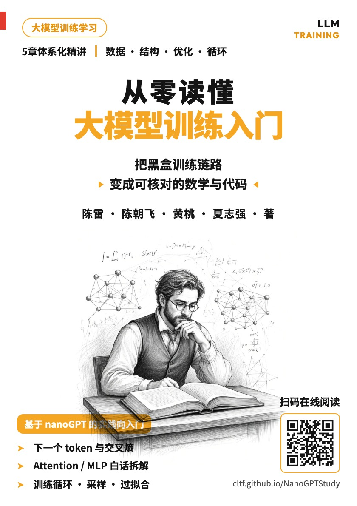

# 大模型训练入门

<p align="center">
  
</p>

<p align="center">
  <strong>从零读懂大模型训练</strong><br />
  把黑盒训练链路变成可核对的数学与代码
</p>

<p align="center">陈雷 · 陈朝飞 · 黄桃 · 夏志强 · 著</p>

---

## 简介

本书面向希望真正搞懂大模型「怎么训起来」的读者，以 **karpathy/nanoGPT** 为可跑通的最小实验场，把训练链路拆成能跟着手算、对着代码核对的五章 + 实战附录。

**你将建立这些直觉：**

- **下一个 token** — 训练在猜什么、Loss 这个数字代表什么
- **Transformer 前向** — Embedding / 因果 Attention / MLP / Softmax 如何分工
- **反向与优化** — 梯度、AdamW、warmup + cosine、梯度裁剪
- **训练循环** — `train.py` 里取数、算分、更新、评估、存盘如何串起来
- **采样与过拟合** — temperature / top-k，以及如何读 train / val 曲线

> 基于 nanoGPT 的实践向入门：少空谈概念，多对照公式、日志与本机曲线。

---

## 在线阅读

站点：[https://cltf.github.io/NanoGPTStudy/](https://cltf.github.io/NanoGPTStudy/)  
封面右下角二维码可扫码直达。

## 本地阅读

用浏览器直接打开即可（样式已内置在本书目录，可独立阅读）：

| 入口 | 说明 |
|------|------|
| [`cover.html`](cover.html) | 封面页（含在线阅读二维码） |
| [`index.html`](index.html) | 总目录（含作者介绍与小节导航） |
| [`ch01.html`](ch01.html) ~ [`ch05.html`](ch05.html) | 五章正文 |
| [`practice.html`](practice.html) | 附录：本机实战过程 |

---

## 目录

1. [下一个字符预测与交叉熵](ch01.html)  
   1.1 数据与词表 · 1.2 自回归与似然 · 1.3 Loss · 1.4 曲线对照 · 1.5 每步在优化什么 · 1.6 扩展
2. [Embedding、Attention 与 MLP](ch02.html)  
   2.1 人话总览 · 2.2 前向链路 · 2.3–2.7 结构拆解 · 2.8 对照现代 LLM
3. [反向传播与 AdamW](ch03.html)  
   3.1 三件套人话版 · 3.2–3.7 机制与调度 · 3.8 预训练旋钮
4. [训练循环全景](ch04.html)  
   4.1 while True 全景 · 4.2 步骤详解 · 4.3 日志 · 4.4 命令效果 · 4.5 源码阅读标注
5. [采样生成与过拟合](ch05.html)  
   5.1 生成路径 · 5.2 Temperature · 5.3 Top-k · 5.4 曲线解读 · 5.5–5.6 质量与调试
6. [附录 · 本机实战过程总结](practice.html)  
   环境 · 数据 · 轻量 v1 / 加强 v2 · 采样 · 时间线 · 理论对照

---

## 作者介绍

- **陈雷**，希望学产研负责人  
- **陈朝飞**，希望学基础架构负责人  
- **黄桃**，希望学业务研发负责人  
- **夏志强**，希望学平台产研负责人  

---

## 仓库说明

| 文件 / 目录 | 用途 |
|-------------|------|
| `images/cover.jpg` | README / 目录页封面图 |
| `images/cover-hero.png` | 封面页主视觉 |
| `images/loss_curve_*.png` | 本机训练曲线 |
| `styles.css` | 本书独立样式 |
| `sections/*.body.html` | 章节正文源稿 |
| `_enrich_from_lessons.py` | 生成 / 加厚章节正文 |
| `_build_book.py` | 套上书籍壳层，输出 `ch*.html` |

重新生成章节（一般不必手动跑；改完源稿后再执行）：

```bash
python3 _enrich_from_lessons.py
python3 _build_book.py
```

`cover.html` 与 `index.html` 为手写维护，不会被脚本覆盖。

---

## License

学习研究用途。正文与配图版权归作者所有，转载或二次分发请注明出处并征得作者同意。
